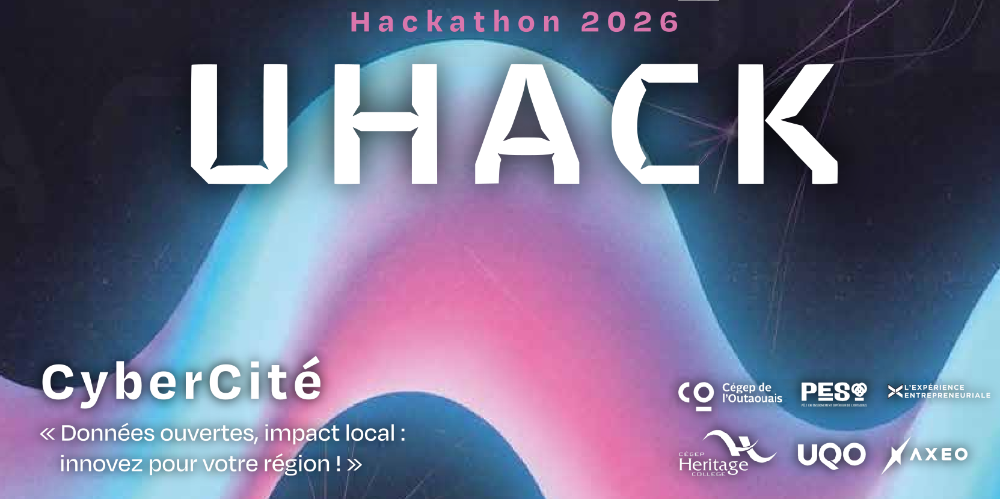

# UHACK2026



Toutes les ressources et la plateforme du UHACK 2026

## Description de l'événement

Les participants, en équipe de 5, jouent dans un scénario de gestion de crise en cybersécurité. Les équipes incarnent des entreprises sous-traitantes et des départements fictifs d'une ville fictive dont la plateforme de gestion des plaintes citoyennes et des services municipaux est visée par une cyberattaque. Les scénarios visent des attaques sur les services routiers, d'aqueduc, d'électricité, de gestion des déchets de signalement citoyen, de communication citoyenne et de services d'urgence.

Les défis viennent en vagues en plus en plus difficiles et de natures différentes.

## Dépendances

> [!WARNING]
> Cette application n'est compatible qu'avec un système linux basé sur debian (i.e. qui utilise `apt`). Exécutez l'application dans une machine virtuelle.
> L'application peut s'exécuter sur WSL, mais la résolution de nom de domaine ne fonctionnera probablement pas. Vous aurez à pointer votre serveur DNS vers `173.10.10.2`

Les dépendances sont installées automatiquement.

## Déploiement

1. Exécutez le script `installer.sh`

```txt
#########################################################################################
#***************************************************************************************#
#*                                                                                     *#
#*  ▉▉╮  ▉▉╮ ▉▉╮  ▉▉╮  ▉▉▉▉▉╮  ▉▉▉▉▉▉▉╮ ▉▉╮  ▉▉╮  ▉▉▉▉▉▉▉╮ ▉▉▉▉▉▉▉╮ ▉▉▉▉▉▉▉╮ ▉▉▉▉▉▉▉╮  *#
#*  ▉▉│  ▉▉│ ▉▉│  ▉▉│ ▉▉╭──▉▉╮ ▉▉╭────╯ ▉▉│ ▉▉╭╯  ╰────▉▉│ ▉▉╭──▉▉│ ╰────▉▉│ ▉▉╭────╯  *#
#*  ▉▉│  ▉▉│ ▉▉▉▉▉▉▉│ ▉▉▉▉▉▉▉│ ▉▉│      ▉▉▉▉╭─╯   ▉▉▉▉▉▉▉│ ▉▉│  ▉▉│ ▉▉▉▉▉▉▉│ ▉▉▉▉▉▉▉╮  *#
#*  ▉▉│  ▉▉│ ▉▉╭──▉▉│ ▉▉╭──▉▉│ ▉▉│      ▉▉╭─▉▉╮   ▉▉╭────╯ ▉▉│  ▉▉│ ▉▉╭────╯ ▉▉╭──▉▉│  *#
#*  ▉▉▉▉▉▉▉│ ▉▉│  ▉▉│ ▉▉│  ▉▉│ ▉▉▉▉▉▉▉╮ ▉▉│ ╰▉▉╮  ▉▉▉▉▉▉▉╮ ▉▉▉▉▉▉▉│ ▉▉▉▉▉▉▉╮ ▉▉▉▉▉▉▉│  *#
#*  ╰──────╯ ╰─╯  ╰─╯ ╰─╯  ╰─╯ ╰──────╯ ╰─╯  ╰─╯  ╰──────╯ ╰──────╯ ╰──────╯ ╰──────╯  *#
#*                                                                                     *#
#***************************************************************************************#
#########################################################################################

Veuillez choisir une option :
 1. Installer le CTF
 2. Désinstaller le CTF
 3. Démarrer le CTF
 4. Mettre le CTF sur pause
 5. Aide

> 1

Installation du CTF

Choisissez un mode de jeu :
  1. Illimité - Vous aurez autant de temps que vous le souhaitez pour finir le CTF
  2. 24h - Vous aurez 24h pour faire le CTF (NE FERMEZ PAS L'ORDINATEUR ENTRE-TEMPS!!)
  3. 48h - Vous aurez 48h pour faire le CTF (NE FERMEZ PAS L'ORDINATEUR ENTRE-TEMPS!!)
> 
```

2. Naviguez vers https://ctfd.uhack.ctf
   > [!WARNING]
   > Votre système / votre navigateur doit reconnaître soit `/etc/hosts` soit `systemd-resolved` pour que cela fonctionne. Il se peut que vous ayez à modifier les paramètre de votre navigateur.
3. Ignorez les avertissements. Le certificat TLS est signé par l'application avec les informations suivantes : 
   |                         |                              |
   |------------------------:|:-----------------------------|
   | Pays                    | CA                           | 
   | État/Province           | QC                           |
   | Localité                | Gatineau                     |
   | Organisation            | UHACK                        |
   | Unité Organisationnelle | UHACK-CTF                    |
   | Nom Courant             | *.uhack.ctf                  |
   | Date                    | Signé lors de l'installation |
   
   Votre navigateur ne reconnaît pas cette organisation et pense que c'est dangereux, mais le tout est parfaitement sécuritaire.

4. Entrez vos identifiants : 
   - Nom d'utilisateur : **pirate**
   - Mot de passe : **Harrr!**

## Structure du dépot

Ce répo comprend toutes les ressources nécessaires au déploiement de l'infrastucture informatique du UHACK 2026.

Il comprend nottamment :

- Un dossier de [défis](./défis/) contenant la liste des défis de l'événement.
- Un serveur [ctfd](https://ctfd.io/) pour gérer la partie geopadie de l'événement.
- Un serveur [smtp](./courriels/) pour émuler les communications courriels entreprise.
- Un dossier [d'infrastructure réseau](./infra-réseau) pour organiser les configurations réseau de l'événement.
- Un dossier [de coordination](./coordination/) pour coordonner le déploiement des différents services (comme la définition des différents comptes, etc...).
- Un dossier [de documentation](./docs/) pour documenter le tout.

## Contribution

Veuillez vous référer au document [CONTRIBUTING.md](./CONTRIBUTING.md) pour vous familiariser avec les lignes directrices de contribution au projet.

## Technologies utilisées

- [CTFd](https://ctfd.io)
- [DNSmasq](https://dnsmasq.org/doc.html)
- [Nginx](https://github.com/nginx/nginx)
- [Docker](https://github.com/docker)
- [Redis](https://redis.io/)
- [MySQL](https://www.mysql.com/)
- [Python](https://www.python.org/)
  - [PyYAML](https://github.com/yaml/pyyaml)
  - [Requests](https://github.com/psf/requests)
- [OpenSSL](https://github.com/openssl/openssl)
- [Curl](https://github.com/curl/curl)
- [jq](https://github.com/jqlang/jq)
- [sshpass](https://sshpass.com/)
- [git](https://git-scm.com/)